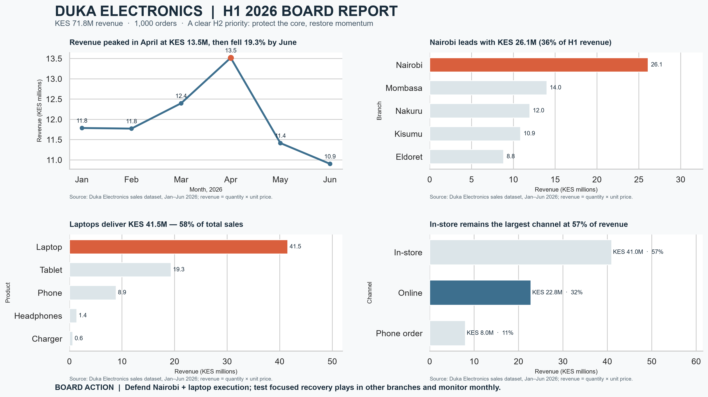

# Duka Electronics | H1 2026 Board Report

## One-page report

## Board Summary (150 words)

The board should protect the revenue engine that is working while treating the slowdown as a testable problem. Duka generated KES 71.8 million from 1,000 orders in January–June 2026. Nairobi contributed KES 26.1 million, 36% of revenue; laptops contributed KES 41.5 million, 58%. These concentrations are strengths, but create exposure if demand or supply shifts. Monthly sales peaked at KES 13.5 million in April and declined to KES 10.9 million in June, 19.3% below the peak. In-store remained the largest channel at KES 41.0 million (57%), while online produced KES 22.8 million (32%). For H2, maintain availability and execution for laptops in Nairobi, then run recovery tests in lower-revenue branches and channels. Review monthly revenue and order counts before scaling. These are descriptive sales totals, not profit results: margins, costs, stock constraints and July–December performance are unavailable, so the report cannot identify causal drivers or establish the most profitable allocation.

## Reproduce the report

From the repository root, install the listed libraries, run `python generate_data.py`, then restart the kernel and run all cells in `board_report.ipynb`. The notebook recreates the report page at `reports/duka_board_report.png` and the makeover images at `figures/before.png` and `figures/after.png`.

## Project files

- `generate_data.py` — Week 3 Duka sales generator (seed 2026).
- `board_report.ipynb` — storyboard, chart code, report and before/after comparison.
- `reports/duka_board_report.png` — single-page four-chart report.
- `figures/before.png`, `figures/after.png` — monthly revenue chart makeover.
- `dashboard.md` — Looker Studio publication status and setup notes.
- `requirements.txt` — pandas, Matplotlib, Seaborn.

The generated `duka_sales.csv` is excluded from Git and regenerated locally by the script.
