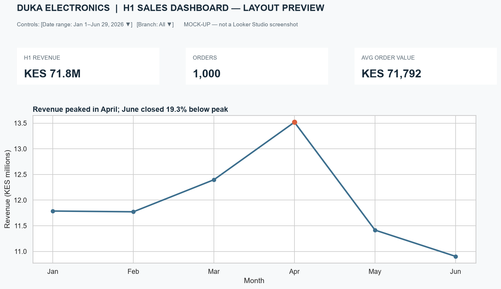
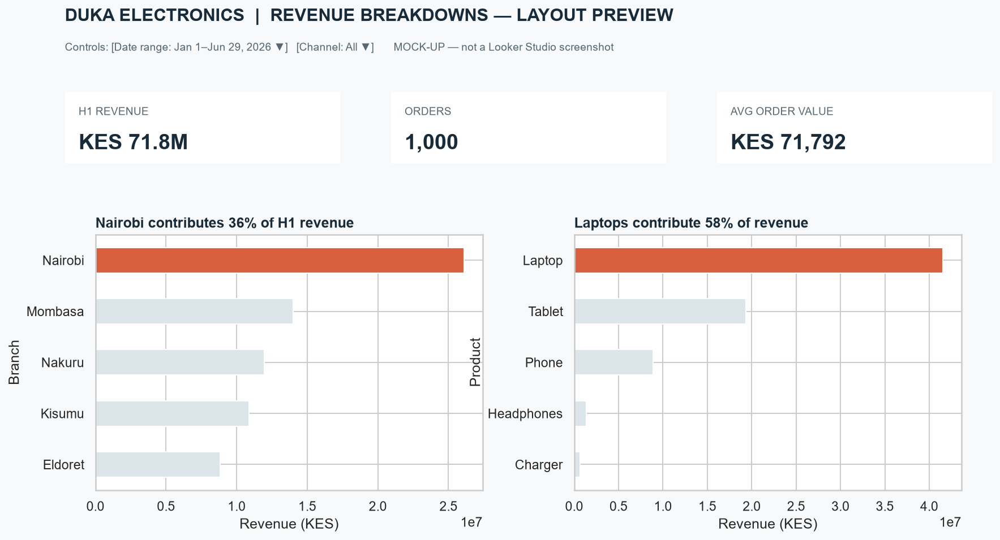

# Looker Studio Dashboard — publication pending

**Public Looker Studio URL:** Not published yet. Google requires an authenticated account to create the report and change its sharing setting to “Anyone with the link can view.” I cannot publish or change sharing permissions from the current unauthenticated browser session. Replace this notice with the published report URL after completing Lab 6.4.

## Dashboard specification

Use the generated `duka_sales.csv` as the data source. Build the dashboard to tell the same H1 story as the board report and include:

- **Scorecards:** H1 revenue, order count, and average order value.
- **Trend:** monthly revenue (Jan–Jun 2026).
- **Breakdowns:** revenue by branch and revenue by product or channel.
- **Controls:** date-range selector and a drop-down filter for branch or channel.
- **Sharing:** Share → General access → Anyone with the link → Viewer.

## Dashboard layout previews (not live Looker Studio screenshots)

These two local previews show the requested layout and evidence, but are **not genuine screenshots of an interactive Looker Studio report**. Replace them with actual captures after publishing and sharing the dashboard.

### Overview — scorecards, trend and controls

### Breakdowns and controls

Required final captures: an overview screenshot and a breakdowns screenshot from the published report, with the scorecards, monthly trend, charts, date-range control and drop-down filter visible.

## Data fields

The source data contains `order_date`, `branch`, `product`, `quantity`, `channel`, and `unit_price`. Add a calculated revenue field as `quantity * unit_price`; use sum of revenue for the sales KPIs and breakdowns. Filter the date range to January 1–June 29, 2026 (the available H1 records).
